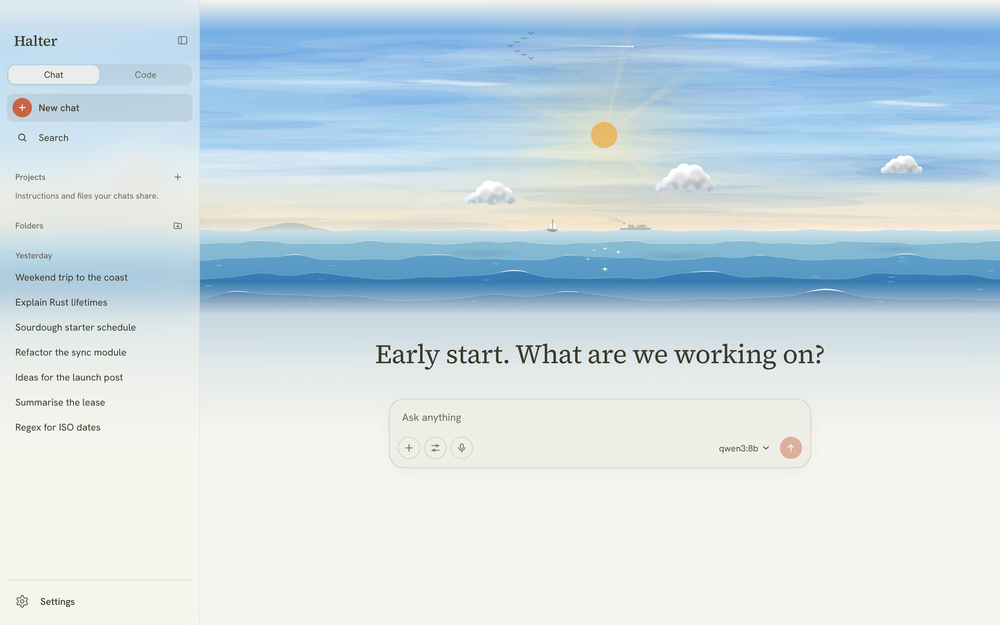
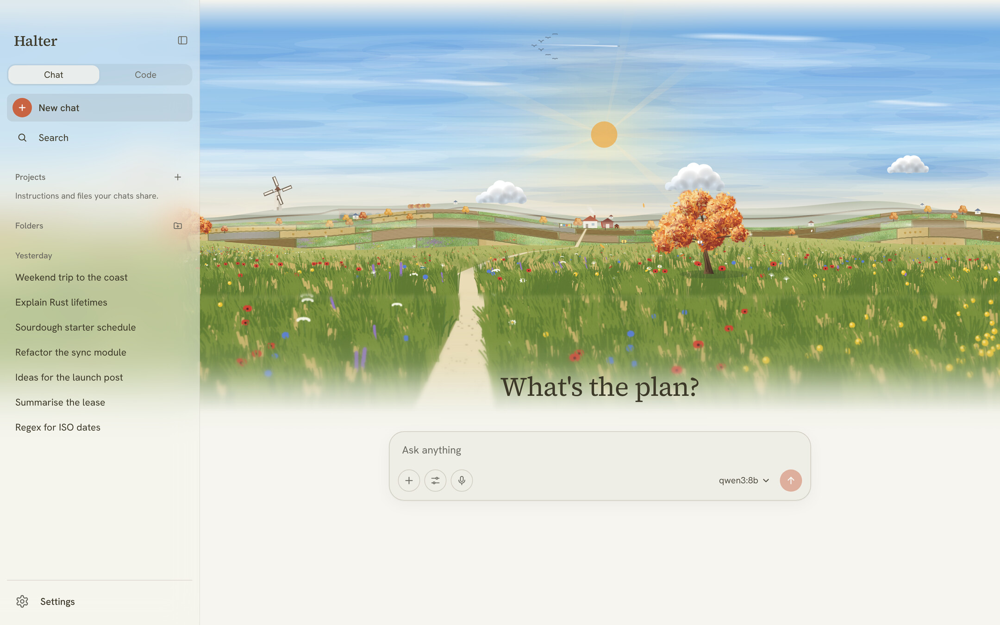
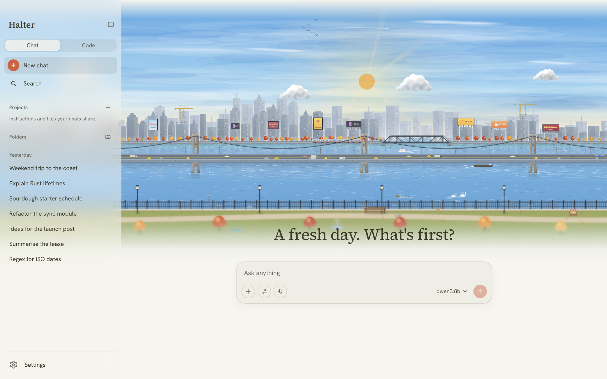
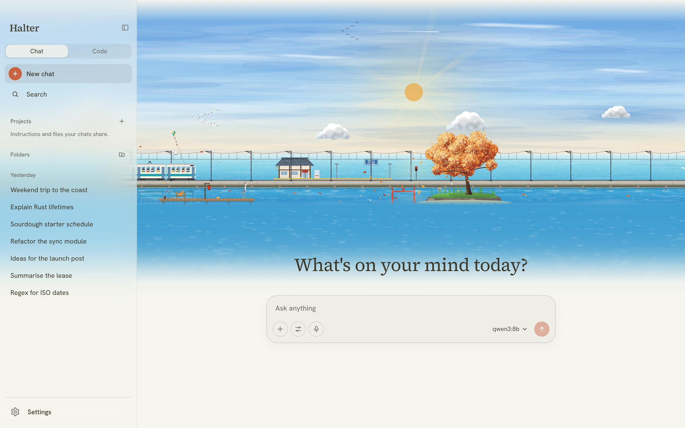
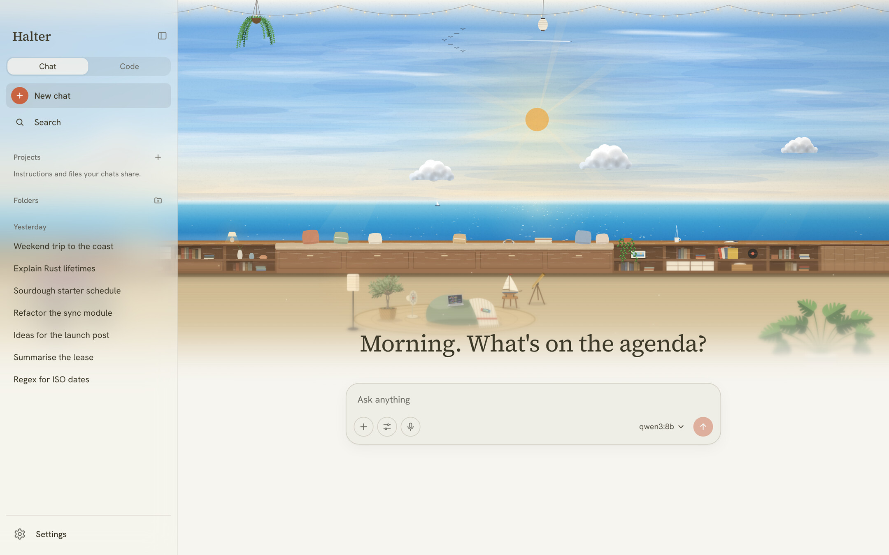
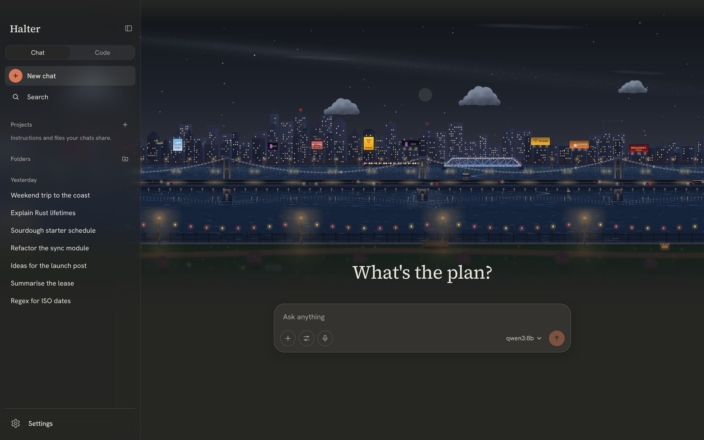
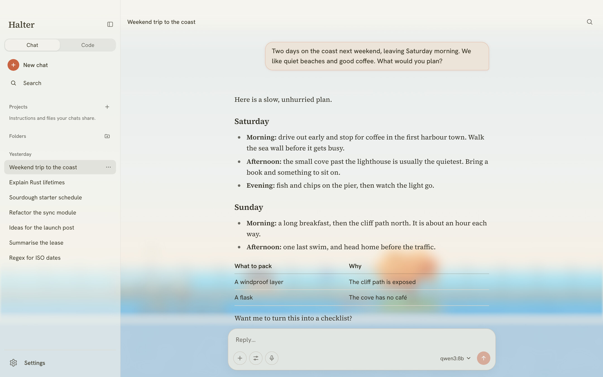
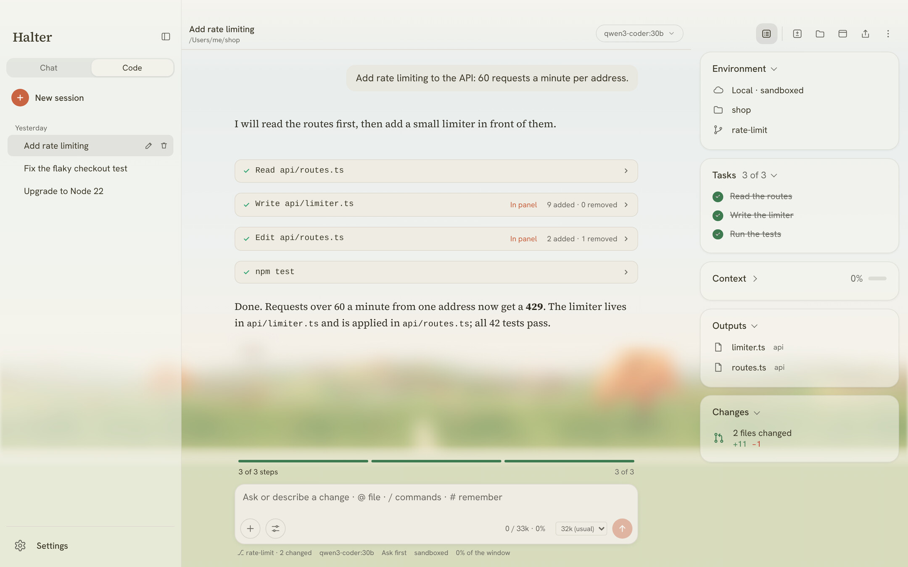
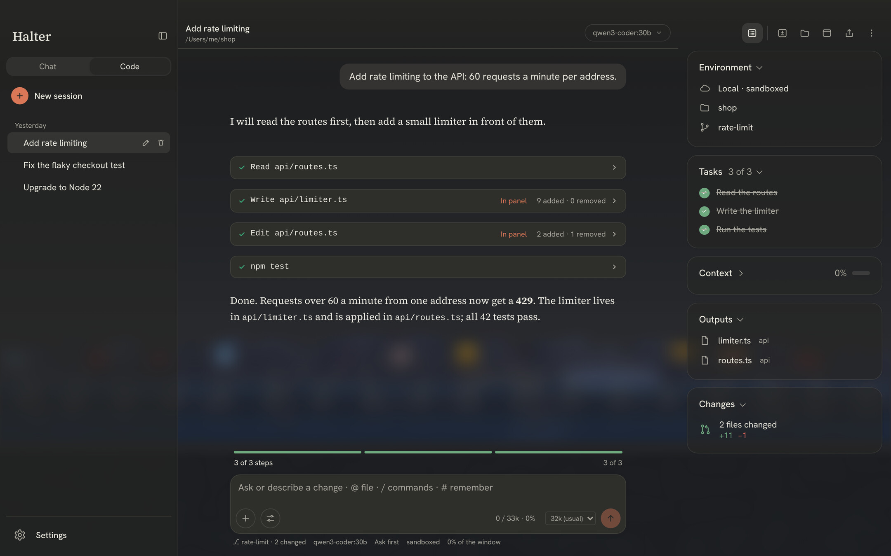

# Halter

A fast, private app for chatting with AI models that run on your own computer.

Halter connects to the model servers you already run, such as Ollama, LM Studio, llama.cpp and vLLM, or any other OpenAI-compatible server. You can also add a cloud provider with your own API key.

## Private by design

- No telemetry.
- No accounts.
- Nothing leaves your machine except calls to the servers you set up.

## Scenes

Pick the view behind your chats.

| Hills | City |
|---|---|
|  |  |

| Seaside | Searoom |
|---|---|
|  |  |

Scenes follow light and dark mode.

## Chat

## Halter Code

An agent that works in a project folder with the model you pick: it reads, edits and runs commands, and shows its tasks and changes beside the conversation.

| Light | Dark |
|---|---|
|  |  |

## Download

**[Download Halter for macOS](https://github.com/abhivirchaudhary/halter-app/releases/latest)** — Apple Silicon, macOS 11 or later.

This is a free build and is not yet notarized, so the first time you open it, right-click **Halter.app → Open** and confirm (or allow it under System Settings → Privacy & Security). After that it opens normally.

Every build is on the [Releases](https://github.com/abhivirchaudhary/halter-app/releases) page.

## About this repo

This repo holds Halter's downloads and release notes. The app's source code is not public.

Made by [Abhivir Chaudhary](https://abhivir.xyz).
